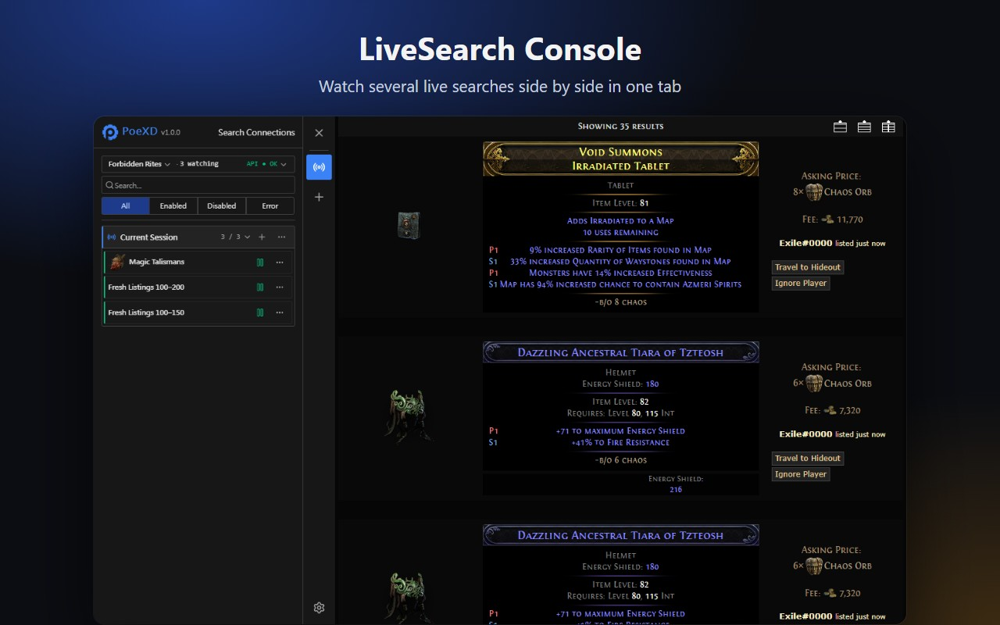
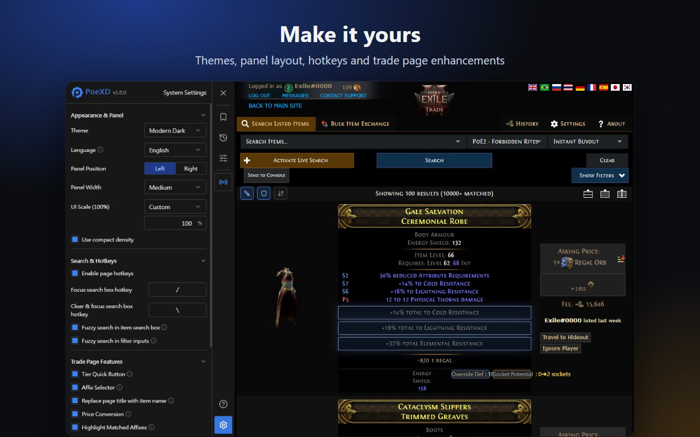

<p align="center">
  
</p>

<p align="center">
  <a href="https://chromewebstore.google.com/detail/fbbkaeekjalfecgjfcephaiopffeobjg"></a>
  <a href="https://microsoftedge.microsoft.com/addons/detail/hnnpgpcnmgjbmmhgogcljbnfoklblgmb"></a>
  <a href="https://yehshune.github.io/poexd/"></a>
  
  
</p>

<p align="center"><a href="./README.md">繁體中文</a> · <b>English</b></p>

**PoeXD Extension** is a helper for the official Path of Exile (PoE 1 / PoE 2) trade site: it adds a
side toolbar next to the trade page so you can watch live searches in one place, apply affixes
quickly, organize bookmarks and PoB shopping lists, and display the international trade site in
Chinese. A full visual walkthrough is available in the
[User Guide (zh-TW)](https://yehshune.github.io/poexd/).

## Install and first run

| Browser                          | How                                                                                                                                                                         |
| :------------------------------- | :-------------------------------------------------------------------------------------------------------------------------------------------------------------------------- |
| Chrome, Brave and other Chromium | [Chrome Web Store](https://chromewebstore.google.com/detail/fbbkaeekjalfecgjfcephaiopffeobjg)                                                                               |
| Microsoft Edge                   | [Edge Add-ons](https://microsoftedge.microsoft.com/addons/detail/hnnpgpcnmgjbmmhgogcljbnfoklblgmb)                                                                          |
| Manual install (no auto-update)  | Download `chromium.zip` from [Releases](https://github.com/yehshune/PoeXD-Extension/releases), unzip, enable Developer mode in `chrome://extensions/`, then "Load unpacked" |

Store versions update automatically and are recommended. Firefox is not available yet.

- Open the [official trade site](https://www.pathofexile.com/trade) (Taiwan and China realms are
  also supported); the PoeXD toolbar appears on the **left** by default (switchable to the right in
  Settings → Panel Position), or collapses down to a single PoeXD badge.
- Click the PoeXD icon in your browser toolbar on a trade page to toggle the sidebar directly (or open quick trade links from other pages); individual modules can be toggled in the sidebar Settings.

## What's new

- **v1.11.0 Result Board & settings redesign**:
  - **Result Board**: gathers the results of the current search in the sidebar so you can filter,
    sort, or switch to the seller list to find sellers holding several instant-buyout results, then
    generate a **stash search regex** that highlights all of them in their stash at once. Load all
    results (up to 100) through the official "load more", and expired hideout links are refreshed
    automatically before travelling.
  - **Settings & first run**: a single searchable settings page with per-module toggles, backup and
    restore covering both PoE 1 and PoE 2, and "Show on page" guides; UI scale is now a fixed-step
    menu and the sidebar is resized by dragging its edge. A tour starts automatically after the
    first install, and the toolbar icon toggles the sidebar on trade pages. Layout, hotkey and
    bookmark UI preferences are now shared between PoE 1 and PoE 2.
  - **Other improvements**: pinned items gain sorting, gold fees and mod ranges, and show
    "seller · listed age" like the Result Board; Market Translation can show English under result
    mods; higher tiers are shown disabled when filtering by item level; price sorting yields to the
    official sort when a result field is clicked; switching leagues with active live searches now
    asks first.
- **v1.10.0 pinned items & faster affix selector**:
  - **Pinned items**: pin a result from its hover toolbar and review it later as an official-style
    card in the sidebar; works on search pages, live search and the LiveSearch Console. Filter,
    drag to reorder or drag out to unpin; sold items are marked as sold, and instant-buyout items
    can travel to the seller's hideout.
  - **Smoother affix selector**: categories with many affixes (e.g. PoE 1 helmets and maps) now
    render progressively instead of freezing for almost a second.
  - **Other fixes**: Market Translation now covers magic and Foulborn item names, the PoB shopping
    list shows a loading state while restoring builds, and dropdowns and sidebar panes share a
    consistent theme.

See [Releases](https://github.com/yehshune/PoeXD-Extension/releases) for the full history.

## Features

See the [User Guide (zh-TW)](https://yehshune.github.io/poexd/) for step-by-step screenshots.

### ⚡ Live search console

Watch multiple live searches from a single tab with automatic reconnects, real-time result cards and
optional notification sounds. Add searches from bookmarks or paste trade URLs directly, group by
bookmark folder, start or stop in batches, switch to a results-only view, filter by connection,
monitor live API rate status, protect the console tab from browser auto-discard, and resume your
previous session after restarting the browser.

<p align="center"></p>

### 🎯 Stat group templates and search preview

Save common conditions (e.g. "Life + total elemental resistance") as groups and overlay them on the
current search without overwriting other filters, with one-click undo and share-code / backup-file
import and export. Clicking a bookmark or history entry's name opens **Search Preview** first (click
the arrow beside the name to open the search directly), where you can tune values, switch condition
group types, overlay individual affixes, or overwrite the bookmark.

<p align="center">
  
  
</p>

### 🔍 Affix filter and tier tools

Open the affix selector beside official filter groups to browse prefixes and suffixes by item class
and item level range, then apply checked stats to the official filters in one go. Tier buttons next
to each filter fill in value ranges (switch mod groups on the left when a stat has multiple sources
on the item class), and affixes can be dragged to reorder or move between groups. PoE 2 tablets,
waystones and radius jewels are supported.

### 💰 Result enhancements

- **Converted prices & sorting**: convert listed prices using poe.ninja rates and sort by converted
  price (international realm).
- **Affix highlight & quick filter**: highlight matching affixes; hover a mod on a result card to
  reveal `+AND` / `+NOT` buttons that add the stat to your filters without triggering a search.
- **PoB copy & PoEDB links**: hover the top-left of a result card to copy English **PoB** item text
  (automatically mapped to English on Taiwan/China realms) or open the item's **PoEDB** page.
- **PoE 2 rune-override estimates**: estimate DPS and defence after rune overrides and sort results.

### 📌 Pinned items

Pin a result from its hover toolbar to save the item with its price, seller and listing time to
the sidebar, then compare it later as an official-style card; works on search pages, live search
and the LiveSearch Console. Filter, drag to reorder or drag out to unpin; sold items are marked as
sold, and instant-buyout items can travel to the seller's hideout. Up to 50 pins per game version,
stored locally in your browser.

### 🧾 Result Board

Gathers the results the current search has already retrieved on a normal search page into the
sidebar (open it from the sidebar or the "Board" button next to the official result count) without
changing the official result list.

- **Item list**: filter and sort by price or listing time; click a result to scroll to and
  highlight the official row, travel to the hideout or pin it.
- **Seller list**: sellers ordered by instant-buyout count and converted total, to buy several
  results in one hideout visit. Pick the items to buy to see a subtotal and a **stash search regex**
  that highlights them in the seller's stash (only guaranteed to tell them apart from that seller's
  other loaded results; you are warned when it cannot).
- **Load more**: always goes through the official "load more" button, one batch or all at once (the
  official cap is 100); visited and sold results are marked. The board keeps nothing once you start
  another search; pin results you want to keep.

### 🧩 PoB shopping list

Paste Path of Building export codes or `poe.ninja`, `pobb.in` and `pastebin` share links (the latter
two require granting access to those sites; codes stay local in your browser) to organize multiple
builds by gear slot and gems, with gear-set and skill-group switching. Translates mods (including
legacy wording) and lets you tune criteria before searching, bookmarking or sending to the
LiveSearch Console.

### 📁 Bookmarks, history and TFT interop

- Tree folders with drag and drop, cover images and hover previews.
- Highlights the bookmark matching the current page and lets you overwrite existing bookmarks with
  the current search; bookmarks automatically follow your current realm and league.
- Automatic search history, plus bookmark import/export with TFT Trade Extension (with a diff
  preview before importing).

<p align="center"></p>

### 🌐 Market translation

Display the international trade site UI, filters and search results in Chinese (Traditional Chinese
for Taiwan-realm terminology or Simplified Chinese for China-realm terminology) without altering the
underlying search query. Enable **Bilingual** mode to show Chinese and English together in affix,
currency and item dropdowns so you can search in either language, and optionally show English under
result mods. When enabled alongside `pobb.in`
permission, `pobb.in` share pages are also translated to Chinese.

### ⚙️ Settings, hotkeys and FAQ

- Adjustable panel position (left by default, switchable to right), theme and UI zoom; resize the
  sidebar by dragging its edge. Settings can be searched, feature modules toggled individually, and
  preferences backed up, restored or reset for both PoE 1 and PoE 2.
- A guided tour starts after the first install and can be replayed with "Take the tour" in Tools & Info;
  settings offer "Show on page" to point at the control they affect.
- Fuzzy search for item names and filters (auto `~`), customizable focus / clear search hotkeys
  (`Backspace` to clear, `Esc` to cancel), and optional item names in browser tab titles.
- Extension UI in Traditional Chinese, Simplified Chinese and English; affix data covers all 11
  languages of the official trade site.
- More troubleshooting tips are listed in the [FAQ (zh-TW)](https://yehshune.github.io/poexd/#faq).

<p align="center"></p>

## Privacy

All data stays in your browser. This project runs no servers and has no analytics or tracking.
See the [privacy policy](./PRIVACY.md); report security issues privately as described in
[SECURITY.md](./SECURITY.md).

## Development

Requires Node.js `>= 22` and pnpm.

```bash
pnpm install
pnpm dev        # Chrome dev mode with hot reload
pnpm test       # unit tests
pnpm compile    # type check
pnpm build      # production build
```

See the [contributing guide](./CONTRIBUTING.md) for the full workflow; architecture and decision
records live in [CONTEXT.md](./CONTEXT.md) and [`docs/`](./docs/). Stack: WXT, Vue 3, TypeScript,
Tailwind CSS 4, Vitest, Playwright.

## Support and license

- PoeXD is free and open source. If it saves you time, consider
  [supporting development](https://yehshune.github.io/support/).
- This is an unofficial community tool, not affiliated with or endorsed by Grinding Gear Games or
  Tencent. "Path of Exile" is a trademark of Grinding Gear Games.
- Source code is under the [MIT License](./LICENSE). Game data in `public/json/` is copyrighted by
  Grinding Gear Games and is not covered by the MIT license; see [NOTICE](./NOTICE.md).
