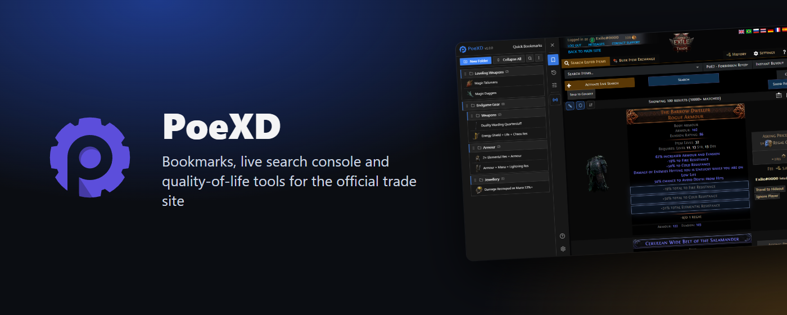
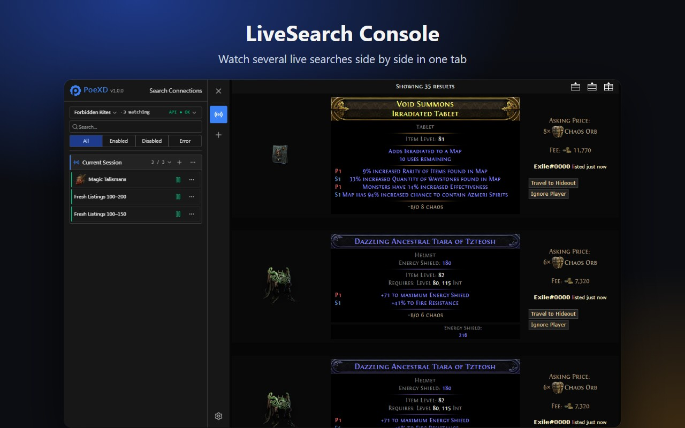
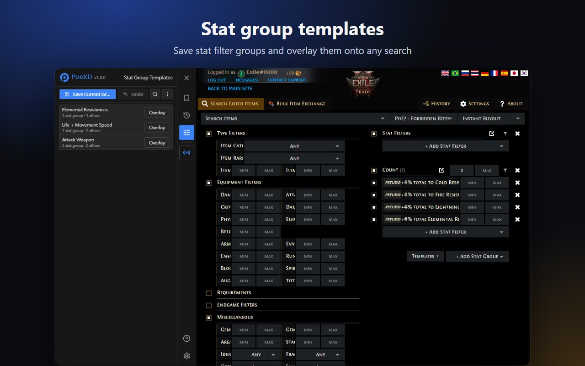
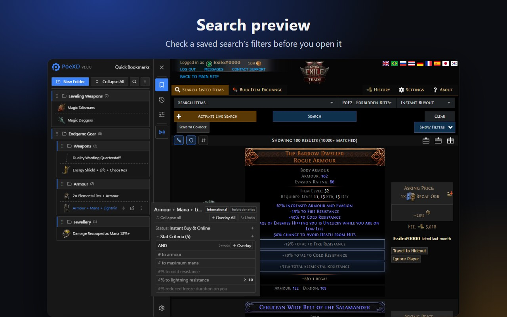
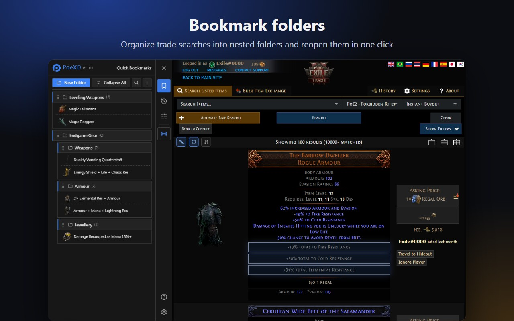
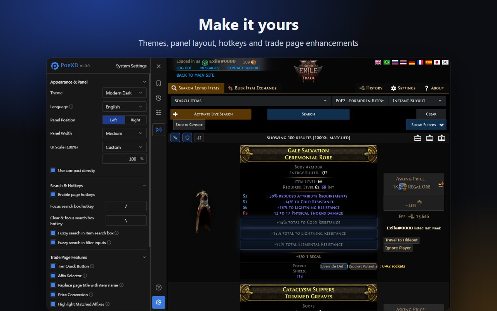

<p align="center">
  
</p>

<p align="center">
  <a href="https://chromewebstore.google.com/detail/fbbkaeekjalfecgjfcephaiopffeobjg"></a>
  <a href="https://microsoftedge.microsoft.com/addons/detail/hnnpgpcnmgjbmmhgogcljbnfoklblgmb"></a>
  
  
</p>

<p align="center"><a href="./README.md">繁體中文</a> · <b>English</b></p>

**PoeXD Extension** is a helper for the official Path of Exile (PoE 1 / PoE 2) trade site: manage
live searches in one place, apply affixes quickly, organize bookmarks, and show the international
trade site in Chinese.

## Install

| Browser                          | How                                                                                                                                                                         |
| :------------------------------- | :-------------------------------------------------------------------------------------------------------------------------------------------------------------------------- |
| Chrome, Brave and other Chromium | [Chrome Web Store](https://chromewebstore.google.com/detail/fbbkaeekjalfecgjfcephaiopffeobjg)                                                                               |
| Microsoft Edge                   | [Edge Add-ons](https://microsoftedge.microsoft.com/addons/detail/hnnpgpcnmgjbmmhgogcljbnfoklblgmb)                                                                          |
| Manual install (no auto-update)  | Download `chromium.zip` from [Releases](https://github.com/yehshune/PoeXD-Extension/releases), unzip, enable Developer mode in `chrome://extensions/`, then "Load unpacked" |

Then open the [official trade site](https://www.pathofexile.com/trade); the PoeXD toolbar appears
on the right. Store versions update automatically. Firefox is not available yet.

## What's new

- **Trade site translation**: show the international (English) trade site with the official
  Traditional or Simplified Chinese wording — UI, filters, dropdowns and results (affixes, item
  names, property labels). Only display text changes; searches are identical to the English page.
  With bilingual mode on, English input still matches.
- **More result rows translated**: the "at max Quality" tooltip, Ultimatum required item and reward
  unique dropdowns, cluster jewel enchants, skills, multi-line mods and mercenary details.
- **Enter search fix**: after typing a value in a filter, the first Enter now searches with that
  value (the official site needed two presses).
- **Affix tools**: PoE 2 radius jewel mods are separated from ordinary jewel tiers; tier ranges are
  fixed for negated stats and cluster jewels; search preview and the mercenary picker use the same
  layout as the affix selector.

See [Releases](https://github.com/yehshune/PoeXD-Extension/releases) for the full history.

## Features

### ⚡ Live search console

Watch many live searches from a single tab with automatic reconnects; group them by bookmark
folder, start or stop in batches, and resume last session's connections. A results-only view,
per-connection filtering and a live API rate indicator help you stay under the official limits.

<p align="center"></p>

### 🎯 Stat group templates and search preview

Save common conditions (e.g. "Life + total elemental resistance") as groups and overlay them on the
current search without touching other filters, with one-click undo; share via codes or backup
files. Search preview shows the real criteria behind history entries and bookmarks, and lets you
overlay individual affixes from them.

<p align="center">
  
  
</p>

### 🔍 Affix filter and tier tools

Browse prefixes and suffixes by item class and write them to the official filters in one go; tier
buttons next to each filter fill in value ranges; drag affixes to reorder or move them between
groups. PoE 2 tablets, waystones and radius jewels are supported.

### 💰 Result enhancements

Price conversion between currencies using poe.ninja rates (international realm), highlighting of
matching affixes, and PoE 2 rune-override DPS / defence estimates with sorting.

### 📁 Bookmarks, history and TFT interop

Tree folders with drag and drop, cover images and hover previews; bookmarks follow your current
realm and league. Search history is recorded automatically. Import and export bookmarks with TFT
Trade Extension, with a diff preview before importing.

<p align="center"></p>

### ⚙️ More

- Fuzzy search for item names and filters (auto `~`), focus / clear search hotkeys, item name in
  the tab title.
- Themes, panel side, width and zoom are adjustable; toggle features from the toolbar popup.
- Extension UI in Traditional Chinese, Simplified Chinese and English; affix data covers all 11
  languages of the official trade site.

<p align="center"></p>

## Privacy

All data stays in your browser. This project runs no servers and has no analytics or tracking.
See the [privacy policy](./PRIVACY.md); report security issues privately as described in
[SECURITY.md](./SECURITY.md).

## Development

Requires Node.js `>= 22` and pnpm.

```bash
pnpm install
pnpm dev        # Chrome dev mode with hot reload
pnpm test       # unit tests
pnpm compile    # type check
pnpm build      # production build
```

See the [contributing guide](./CONTRIBUTING.md) for the full workflow; architecture and decision
records live in [CONTEXT.md](./CONTEXT.md) and [`docs/`](./docs/). Stack: WXT, Vue 3, TypeScript,
Tailwind CSS 4, Vitest, Playwright.

## Support and license

- PoeXD is free and open source. If it saves you time, consider
  [supporting development](https://yehshune.github.io/support/).
- This is an unofficial community tool, not affiliated with or endorsed by Grinding Gear Games or
  Tencent. "Path of Exile" is a trademark of Grinding Gear Games.
- Source code is under the [MIT License](./LICENSE). Game data in `public/json/` is copyrighted by
  Grinding Gear Games and is not covered by the MIT license; see [NOTICE](./NOTICE.md).
