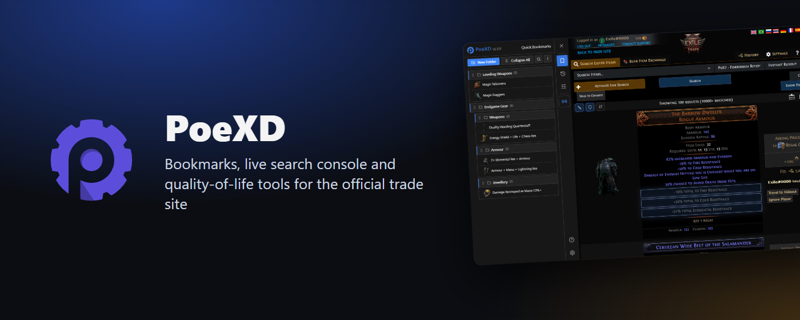

<p align="center">
  
</p>

<p align="center">
  <a href="https://chromewebstore.google.com/detail/fbbkaeekjalfecgjfcephaiopffeobjg"></a>
  <a href="https://microsoftedge.microsoft.com/addons/detail/hnnpgpcnmgjbmmhgogcljbnfoklblgmb"></a>
  <a href="https://yehshune.github.io/poexd/"></a>
  
  
</p>

<p align="center"><a href="./README.md">繁體中文</a> · <b>English</b></p>

**PoeXD Extension** is a helper for the official Path of Exile (PoE 1 / PoE 2) trade site: it adds a side toolbar next to the trade page so you can watch live searches in one place, apply affixes quickly, organize bookmarks and PoB shopping lists, and display the international trade site in Chinese.

<p align="center"><a href="https://yehshune.github.io/poexd/"><b>👉 Full feature tour and screenshots: PoeXD User Guide (zh-TW)</b></a></p>

## Install

| Browser                          | How                                                                                                                                                                         |
| :------------------------------- | :-------------------------------------------------------------------------------------------------------------------------------------------------------------------------- |
| Chrome, Brave and other Chromium | [Chrome Web Store](https://chromewebstore.google.com/detail/fbbkaeekjalfecgjfcephaiopffeobjg)                                                                               |
| Microsoft Edge                   | [Edge Add-ons](https://microsoftedge.microsoft.com/addons/detail/hnnpgpcnmgjbmmhgogcljbnfoklblgmb)                                                                          |
| Manual install (no auto-update)  | Download `chromium.zip` from [Releases](https://github.com/yehshune/PoeXD-Extension/releases), unzip, enable Developer mode in `chrome://extensions/`, then "Load unpacked" |

Store versions update automatically and are recommended. Firefox is not available yet. After installing, open the [official trade site](https://www.pathofexile.com/trade) (Taiwan and China realms are also supported): the PoeXD toolbar appears on the left and a guided tour starts on first run. See [first run](https://yehshune.github.io/poexd/#first-run).

## Features

| Feature                                                                                   | What it does                                                                                                                |
| :---------------------------------------------------------------------------------------- | :-------------------------------------------------------------------------------------------------------------------------- |
| [⚡ Live search console](https://yehshune.github.io/poexd/#live-search)                   | Watch several live searches in one tab with auto-reconnect, sound and desktop notifications                                 |
| [🎯 Stat group templates & search preview](https://yehshune.github.io/poexd/#stat-groups) | Save frequent filters as groups, overlay them onto any search, preview and tweak before opening                             |
| [🔍 Affix filter & tier tools](https://yehshune.github.io/poexd/#affix)                   | Browse affixes by item class and item level; pick a tier to fill in its value range                                         |
| [💰 Result enhancements](https://yehshune.github.io/poexd/#results)                       | poe.ninja price conversion and sorting, affix highlights, PoB copy, PoEDB links, rune previews                              |
| [📌 Pinned items](https://yehshune.github.io/poexd/#pinned)                               | Keep results with price and seller in the sidebar to compare later; sold items are marked                                   |
| [🧾 Result Board](https://yehshune.github.io/poexd/#result-board)                         | Filter and sort a search's results, find sellers with several buyouts and copy a stash regex                                |
| [🧩 PoB shopping list](https://yehshune.github.io/poexd/#pob)                             | Import PoB codes or share links, view gear as a paper doll and search each slot in one click                                |
| [📁 Bookmarks, history & TFT interop](https://yehshune.github.io/poexd/#bookmarks)        | Nested folders with custom icons and colors, automatic history, TFT import and export                                       |
| [🌐 Market translation](https://yehshune.github.io/poexd/#translation)                    | Show the international trade site in Traditional or Simplified Chinese, optionally bilingual                                |
| [⚙️ Settings & FAQ](https://yehshune.github.io/poexd/#settings)                           | Themes and custom palettes, UI scale, hotkeys, module toggles, backup; see the [FAQ](https://yehshune.github.io/poexd/#faq) |

## What's new

**v1.13.0 PoB paper doll & Result Board mod filters**

- **PoB shopping list**: a new paper-doll gear view (now the default) follows the in-game equipment layout with item art, sockets and links, socketed gems / runes / abyss jewels, and corrupted and foulborn marks. Rare items can be searched by category plus defence type, with defence minimums, a pseudo-totals default and a non-unique filter so same-base uniques stay out.
- **Result Board**: required mod and tier filters, better keyword search, and an opt-in sync that filters the official result list as well.
- **Bookmarks**: folders get custom icons and colors; dragging now uses vertical drop zones, stays smooth with large trees, and pressing `Esc` cancels a drag without moving anything.
- **Other improvements**: localized PoB class names with ascendancy icons; empty filter results show the active filters with a reset button; the page guide's appearance step can toggle compact density.

Full history is on [Releases](https://github.com/yehshune/PoeXD-Extension/releases).

## Feedback

Report bugs and feature requests on [GitHub Issues](https://github.com/yehshune/PoeXD-Extension/issues). Including the extension version, browser, PoE 1 or 2, realm (International / Taiwan / China) and steps to reproduce helps a lot. Never post your `POESESSID` or other cookies.

## Privacy

All data stays in your browser. This project runs no servers and has no analytics or tracking.
See the [privacy policy](./PRIVACY.md); report security issues privately as described in
[SECURITY.md](./SECURITY.md).

## Development

Requires Node.js `>= 22` and pnpm.

```bash
pnpm install
pnpm dev        # Chrome dev mode with hot reload
pnpm test       # unit tests
pnpm compile    # type check
pnpm build      # production build
```

See the [contributing guide](./CONTRIBUTING.md) for the full workflow; architecture and decision
records live in [GLOSSARY.md](./GLOSSARY.md) and [`docs/`](./docs/). Stack: WXT, Vue 3, TypeScript,
Tailwind CSS 4, Vitest, Playwright.

## Support and license

- PoeXD is free and open source. If it saves you time, consider
  [supporting development](https://yehshune.github.io/support/).
- This is an unofficial community tool, not affiliated with or endorsed by Grinding Gear Games or
  Tencent. "Path of Exile" is a trademark of Grinding Gear Games.
- Source code is under the [MIT License](./LICENSE). Game data in `public/json/` is copyrighted by
  Grinding Gear Games and is not covered by the MIT license; see [NOTICE](./NOTICE.md).
