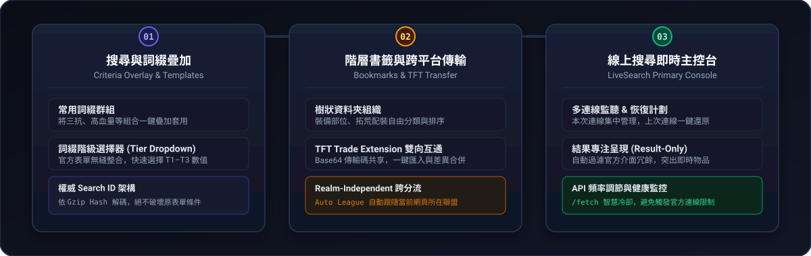

<p align="center">
  
</p>

<p align="center">
  <a href="https://github.com/yehshune/PoeXD-Extension/actions"></a>
  
  
  
</p>

<p align="center"><a href="./README.md">繁體中文</a> · <b>English</b></p>

---

## About

**PoeXD Extension** is a browser extension for the official trade site of Path of Exile 1 and
Path of Exile 2.

It targets the pain points of heavy trade users: watching many live searches at once, tweaking
stat filters repeatedly, and organizing searches across leagues. It adds a **LiveSearch console**,
**stat group templates**, **hierarchical bookmarks** and **two-way compatibility with TFT Trade
Extension**, without getting in the way of the official site.

---

## Features

### ⚡ LiveSearch console

- **Many connections, one tab**: manage multiple live searches from a single console tab instead
  of a dozen memory-hungry tabs, with automatic reconnection.
- **Groups and batch actions**: connections are grouped by bookmark folder; filter them by
  keyword and start or stop them in bulk, or start a whole folder at once.
- **Resume plan**: remembers which live searches were active; on restart you can clear them,
  restore them manually or restore them automatically.
- **Result-only presentation**: hides the official header and unrelated panels to give results
  and live notifications as much room as possible. Click a connection to show only its results,
  and set a cap on how many results are kept.
- **Rate-limit protection**: monitors the `/fetch` request rate and connection health
  (`API ● OK` / `API ◐ waiting Xs`) to avoid hitting the official rate limits.
- **Temporary search**: paste any trade URL, or push an existing search, and start watching it
  without creating a bookmark first.

<p align="center">
  
</p>

### 🎯 Stat group templates & criteria overlay

- **Reusable stat groups**: capture common filter sets (for example "life + total elemental
  resistance") from the current page and save them as templates.
- **Non-destructive overlay**: apply a stat group on top of the current search form without
  touching the item type or other filters, and undo the last overlay with one click.
- **Drag-and-drop management**: reorder templates by dragging, drop them on the trash to delete,
  rename them and search them by keyword.
- **Share codes and backup files**: import and export templates to move them between computers
  or share them with friends.
- **Search preview**: decode and inspect the real query behind any history entry or bookmark, and
  overlay selected stat groups with one click.

<p align="center">
  
  
</p>

### 🔍 Affix filter & tier tools

- **Affix filter pane**: browse every affix that can roll on an item category, split into prefix
  and suffix columns, with keyword search and quick jumps.
- **Batch apply**: queue affixes or specific tiers and write them into the official filters at
  once, or apply top-tier (T1) values to all of them. Affixes without an official ID are typed
  into the search box instead.
- **Tier dropdown**: a T-tier button next to each stat in the official form fills the matching
  value range; you can also switch item category or mod group and fine-tune min/max values.
- **Affix selector**: a quick-search popup next to each stat group finds affixes faster than the
  official dropdown.
- **Drag stats between groups**: drag a stat row by its checkbox to reorder it within an official
  stat group, or move it to another group.
- **Tablets and waystones**: PoE 2 precursor tablet (per mechanic) and waystone (per tier)
  affixes can be browsed and applied from the pane as well.

### 💰 Result enhancements

- **Price comparison**: converts listings priced in divine orbs, chaos orbs and other currencies
  using live poe.ninja exchange rates (international realm only).
- **Result mod highlight**: highlights the mods in each result that match your filters.
- **Rune override calculator (PoE 2)**: pick a target rune to estimate each weapon's or armour
  piece's DPS and defences after overriding its runes, see socket potential, and re-sort results
  by overridden value or value for money.

### 📁 Hierarchical bookmarks, history & TFT transfer

- **Nested folders**: organize searches by class, league stage or build. Bookmarks and folders
  can be reordered and moved between folders by dragging, and dropped on the trash to delete.
- **Covers and hover previews**: pick an item image from the results as a bookmark cover, and
  hover a bookmark to preview the item.
- **Flexible opening**: open a bookmark in the current or a new tab, send it straight to the
  LiveSearch console, or add the current page to a folder in one click.
- **Search history**: searches are recorded automatically and can be searched, previewed,
  bookmarked or sent to the console.
- **Auto league**: bookmarks are realm-independent and follow the server and league you are
  browsing, or can be pinned to a specific league.
- **TFT Trade Extension compatible**: import and export TFT bookmark folders via the standard
  Base64 transfer code, or use backup files. Preview the changes before importing and choose to
  add, merge or replace.

<p align="center">
  
</p>

### ⚙️ Page tweaks & personalization

- **Trade page tweaks**: fuzzy search in the item name and filter inputs (adds `~`
  automatically), hotkeys to focus or clear the search box, item names as tab titles, and an
  option to hide the official background.
- **Personalization**: several themes, left or right sidebar, adjustable width and UI scale.
- **Module toggles**: click the extension icon in the toolbar to turn individual trade page
  features on or off.
- **Market Translation**: shows the international English Trade site (PoE 1 and PoE 2) in
  Traditional or Simplified Chinese using each official realm's wording: interface, filters,
  dropdowns and result rows (mods, item names). Only display text changes, so searches are
  identical to the English site; an optional bilingual mode keeps English searchable.

<p align="center">
  
</p>

### 🌐 Native support for PoE 1 & PoE 2

- **Localized data**: bundled stat dictionaries, item names and category mappings for both games
  in all 11 official trade site languages. The extension UI is available in English, Traditional
  Chinese and Simplified Chinese.
- **Separate runtimes**: PoE 1 and PoE 2 consoles each have their own background coordinator.

---

## Architecture

<p align="center">
  
</p>

1. **The search ID is the source of truth (ADR-0008)**
   The short code in an official trade URL identifies the stored query. PoeXD treats it as the
   canonical search ID and never keeps stale copies of query criteria, so previews and overlays
   always match the official search.
2. **Main-world adapters, non-intrusive integration**
   Lightweight adapters in `entrypoints/main-world/` observe the official Vue runtime and only
   mount extension controls when the official state changes.
3. **Background-owned coordination**
   Live search connections are coordinated by the background service worker, so they recover
   reliably across tab switches, network drops and browser sleep.

---

## Installation

### Option 1: Extension stores (recommended)

- **Chrome**: Chrome Web Store (under review)
- **Edge, Brave and other Chromium browsers**: install from the Chrome Web Store (on Edge, allow
  "extensions from other stores" first)

Store versions update automatically. PoeXD is not listed on Edge Add-ons or Firefox Add-ons yet.

### Option 2: Manual install (Chrome / Edge / Brave / Opera)

1. Download `poexd-extension-<version>-chromium.zip` from
   [Releases](https://github.com/yehshune/PoeXD-Extension/releases) and unzip it.
2. Open `chrome://extensions/` (`edge://extensions/` on Edge) and enable **Developer mode**.
3. Click **Load unpacked** and select the unzipped folder.
4. Open the [official trade site](https://www.pathofexile.com/trade); the PoeXD toolbar appears
   on the right.

> Manually installed builds **do not update automatically**. Download new releases, unzip over
> the same folder, then click "Reload" on the extensions page. Your local data is kept when you
> update in place.
>
> There is no Firefox release yet (Firefox does not allow unsigned extensions).

### Option 3: Build from source (developers)

Requirements: **Node.js** `>= 22`, **pnpm** (see `packageManager` in `package.json`).

```bash
git clone https://github.com/yehshune/PoeXD-Extension.git
cd PoeXD-Extension
pnpm install

pnpm dev               # Chrome with hot reload
pnpm dev:firefox       # Firefox
pnpm test              # unit tests
pnpm compile           # type check
pnpm format            # format code

pnpm build             # .output/chrome-mv3
pnpm build:firefox     # .output/firefox-mv3
pnpm zip               # release zips
POEXD_STORE_BUILD=1 pnpm zip   # store build without the fixed-ID manifest key
```

---

## Tech stack

| Area                | Choice                                                                      |
| :------------------ | :-------------------------------------------------------------------------- |
| Extension framework | [WXT](https://wxt.dev/)                                                     |
| UI                  | [Vue 3](https://vuejs.org/) + [TypeScript](https://www.typescriptlang.org/) |
| Components          | [Reka UI](https://reka-ui.com/) + [Lucide](https://lucide.dev/)             |
| Styling             | [Tailwind CSS 4](https://tailwindcss.com/)                                  |
| Messaging           | `@webext-core/messaging`                                                    |
| Testing             | [Vitest](https://vitest.dev/) + [Playwright](https://playwright.dev/)       |

---

## Documentation

Architecture decisions and contracts live in `docs/` (mostly in Traditional Chinese):

- [Domain context](./CONTEXT.md)
- [ADR-0007: TFT transfer](./docs/adr/0007-realm-independent-bookmarks-and-tft-transfer.md)
- [ADR-0008: Search ID as source of truth](./docs/adr/0008-search-id-is-the-source-of-query-criteria.md)
- [ADR-0010: Stat group templates and preview overlay](./docs/adr/0010-stat-group-templates-and-preview-overlay-replace-filter-presets.md)
- [LiveSearch console contract](./docs/architecture/live-search-primary-contract.md)

---

## Privacy & permissions

- All data stays in your browser. The project runs no server and contains no analytics or
  tracking.
- See the [privacy policy](./PRIVACY.md). Report security issues privately as described in
  [SECURITY.md](./SECURITY.md).

---

## Support

PoeXD is free and open source. If it saves you time, you can support its development on the
[support page](https://yehshune.github.io/support/).

---

## Contributing

Issues and pull requests are welcome. Please read [CONTRIBUTING.md](./CONTRIBUTING.md) first.

---

## Disclaimer & license

- **Disclaimer**: this is an unofficial, community-made tool. It is not affiliated with, endorsed
  by, or sponsored by Grinding Gear Games or Tencent. "Path of Exile" is a trademark of Grinding
  Gear Games.
- **License**: source code is released under the [MIT License](./LICENSE). Game data in
  `public/json/` is © Grinding Gear Games and is not covered by the MIT License; see
  [NOTICE](./NOTICE.md).
