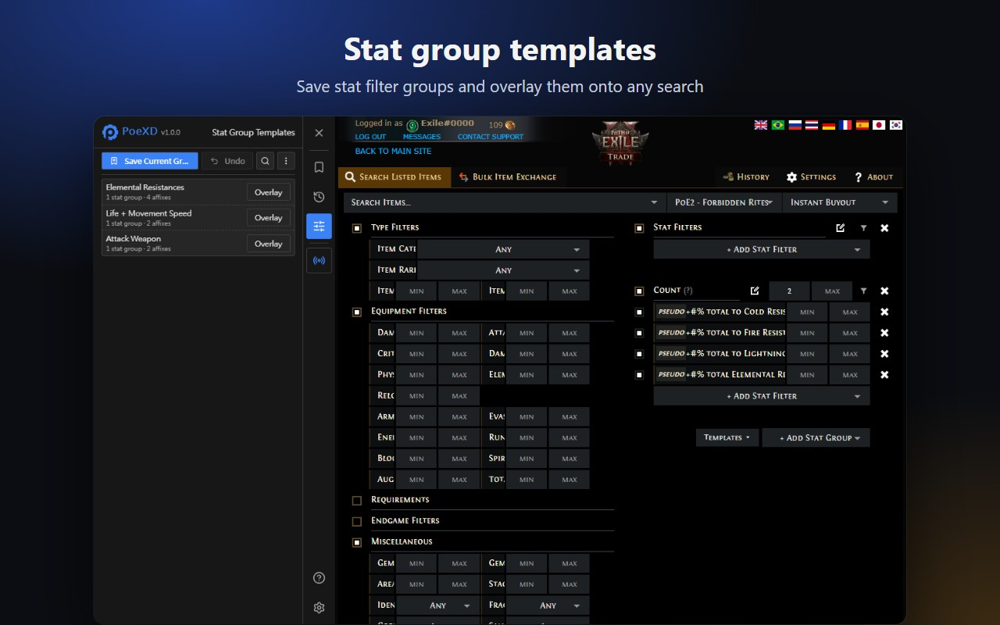
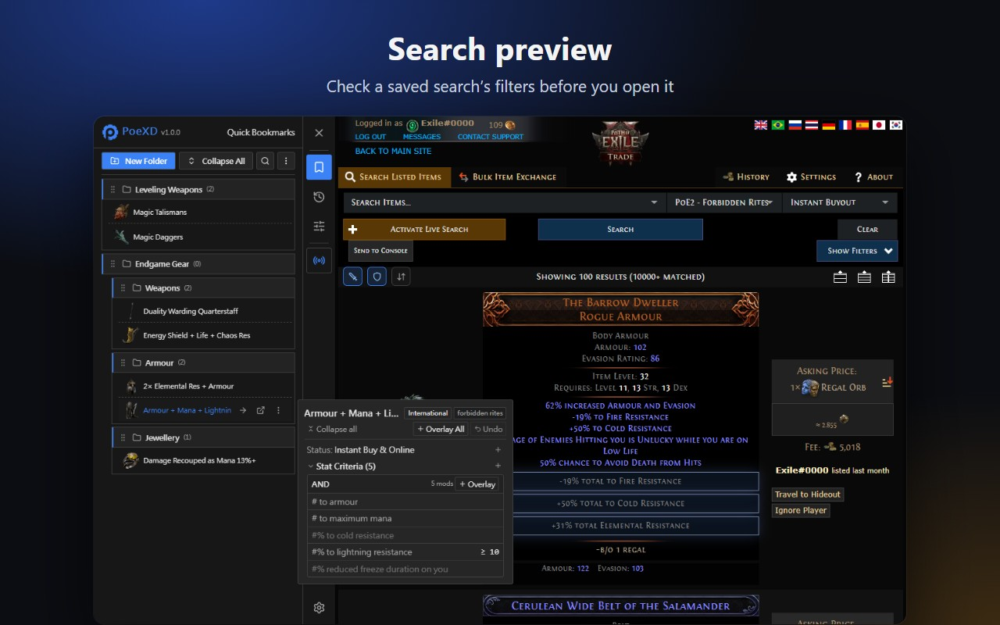
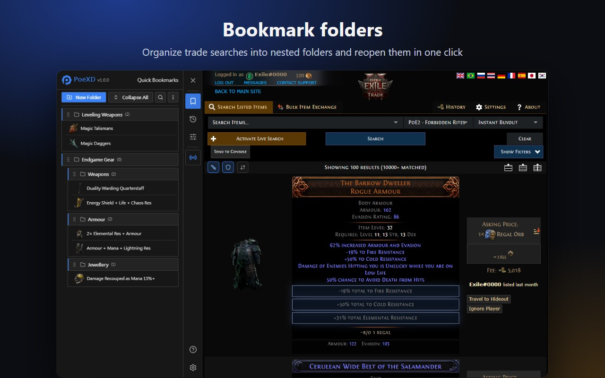

<p align="center">
  
</p>

<p align="center">
  <a href="https://chromewebstore.google.com/detail/fbbkaeekjalfecgjfcephaiopffeobjg"></a>
  <a href="https://microsoftedge.microsoft.com/addons/detail/hnnpgpcnmgjbmmhgogcljbnfoklblgmb"></a>
  
  
</p>

<p align="center"><a href="./README.md">繁體中文</a> · <b>English</b></p>

**PoeXD Extension** is a helper for the official Path of Exile (PoE 1 / PoE 2) trade site: manage
live searches in one place, apply affixes quickly, organize bookmarks, and show the international
trade site in Chinese.

## Install

| Browser                          | How                                                                                                                                                                         |
| :------------------------------- | :-------------------------------------------------------------------------------------------------------------------------------------------------------------------------- |
| Chrome, Brave and other Chromium | [Chrome Web Store](https://chromewebstore.google.com/detail/fbbkaeekjalfecgjfcephaiopffeobjg)                                                                               |
| Microsoft Edge                   | [Edge Add-ons](https://microsoftedge.microsoft.com/addons/detail/hnnpgpcnmgjbmmhgogcljbnfoklblgmb)                                                                          |
| Manual install (no auto-update)  | Download `chromium.zip` from [Releases](https://github.com/yehshune/PoeXD-Extension/releases), unzip, enable Developer mode in `chrome://extensions/`, then "Load unpacked" |

Then open the [official trade site](https://www.pathofexile.com/trade); the PoeXD toolbar appears
on the right. Store versions update automatically. Firefox is not available yet.

## What's new

- **PoB shopping list & `pobb.in` translation**: added a PoB Shopping List tab in the sidebar to
  import Path of Building codes or `poe.ninja`, `pobb.in` and `pastebin` share links (optional
  host permission for the latter two) across multiple builds; items are grouped by gear slot and
  gems, with mod translation (including legacy wording), a tuning popover before searching, and
  one-click search, bookmarking or sending to the LiveSearch Console. With `pobb.in` permission and
  Market Translation enabled, `pobb.in` share pages are also translated to Chinese.
- **PoB copy, PoEDB links & converted-price sorting on results**: added buttons on the top-left
  hover strip of result cards to copy English PoB item text or open the item's PoEDB page (mapping
  Taiwan/China realm names back to English), plus converted-price sorting (asc/desc) for both PoE 1
  and PoE 2.
- **Unified search preview tuning**: bookmark and history search previews now share the same mod
  tuning popover and stat domain badges as the PoB shopping list so you can adjust criteria before
  applying or opening a search.
- **Affix selector, bookmark & Market Translation improvements**: added an item level range filter
  and fixed multi-affinity mod groups in the affix selector; added bookmark overwrite with the
  current search and active-search highlighting; added a sidebar update notice and welcome banner;
  expanded Market Translation coverage (discriminant, legacy and transfigured items) and synced
  bundled data shards.

See [Releases](https://github.com/yehshune/PoeXD-Extension/releases) for the full history.

## Features

### ⚡ Live search console

Watch many live searches from a single tab with automatic reconnects; group them by bookmark
folder, start or stop in batches, and resume last session's connections. A results-only view,
per-connection filtering and a live API rate indicator help you stay under the official limits.

<p align="center"></p>

### 🎯 Stat group templates and search preview

Save common conditions (e.g. "Life + total elemental resistance") as groups and overlay them on the
current search without touching other filters, with one-click undo; share via codes or backup
files. Search preview shows the real criteria behind history entries and bookmarks, and lets you
overlay individual affixes from them.

<p align="center">
  
  
</p>

### 🔍 Affix filter and tier tools

Browse prefixes and suffixes by item class and item level range, and write them to the official
filters in one go; tier buttons next to each filter fill in value ranges; drag affixes to reorder or
move them between groups. PoE 2 tablets, waystones and radius jewels are supported.

### 💰 Result enhancements

Price conversion between currencies using poe.ninja rates with converted-price sorting
(international realm), highlighting of matching affixes, one-click English PoB item copy and PoEDB
links, and PoE 2 rune-override DPS / defence estimates with sorting.

### 🧩 PoB shopping list

Import Path of Building codes or `poe.ninja`, `pobb.in` and `pastebin` share links to organize
multiple builds by gear slot and gems; translate mods, tune search criteria and search, bookmark or
send items to the LiveSearch Console in one click. When `pobb.in` permission and Market Translation
are enabled, `pobb.in` pages are also displayed in Chinese.

### 📁 Bookmarks, history and TFT interop

Tree folders with drag and drop, cover images, hover previews, active-search highlighting and
overwriting with the current search; bookmarks follow your current realm and league. Search history
is recorded automatically. Import and export bookmarks with TFT Trade Extension, with a diff preview
before importing.

<p align="center"></p>

### ⚙️ More

- Fuzzy search for item names and filters (auto `~`), focus / clear search hotkeys, item name in
  the tab title.
- Themes, panel side, width and zoom are adjustable; toggle features from the toolbar popup.
- Extension UI in Traditional Chinese, Simplified Chinese and English; affix data covers all 11
  languages of the official trade site.

<p align="center"></p>

## Privacy

All data stays in your browser. This project runs no servers and has no analytics or tracking.
See the [privacy policy](./PRIVACY.md); report security issues privately as described in
[SECURITY.md](./SECURITY.md).

## Development

Requires Node.js `>= 22` and pnpm.

```bash
pnpm install
pnpm dev        # Chrome dev mode with hot reload
pnpm test       # unit tests
pnpm compile    # type check
pnpm build      # production build
```

See the [contributing guide](./CONTRIBUTING.md) for the full workflow; architecture and decision
records live in [CONTEXT.md](./CONTEXT.md) and [`docs/`](./docs/). Stack: WXT, Vue 3, TypeScript,
Tailwind CSS 4, Vitest, Playwright.

## Support and license

- PoeXD is free and open source. If it saves you time, consider
  [supporting development](https://yehshune.github.io/support/).
- This is an unofficial community tool, not affiliated with or endorsed by Grinding Gear Games or
  Tencent. "Path of Exile" is a trademark of Grinding Gear Games.
- Source code is under the [MIT License](./LICENSE). Game data in `public/json/` is copyrighted by
  Grinding Gear Games and is not covered by the MIT license; see [NOTICE](./NOTICE.md).
