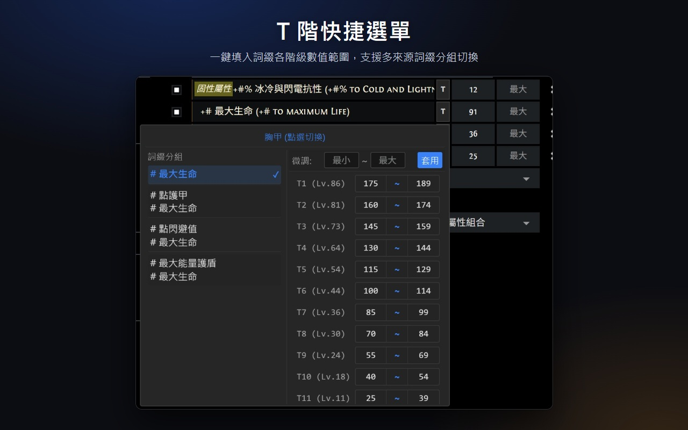
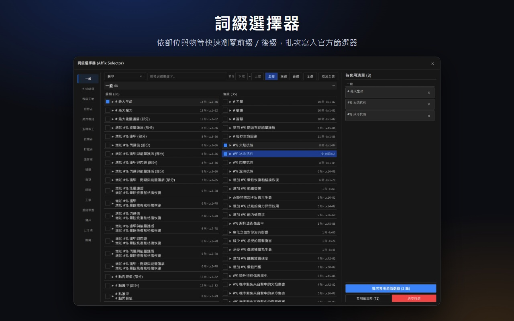
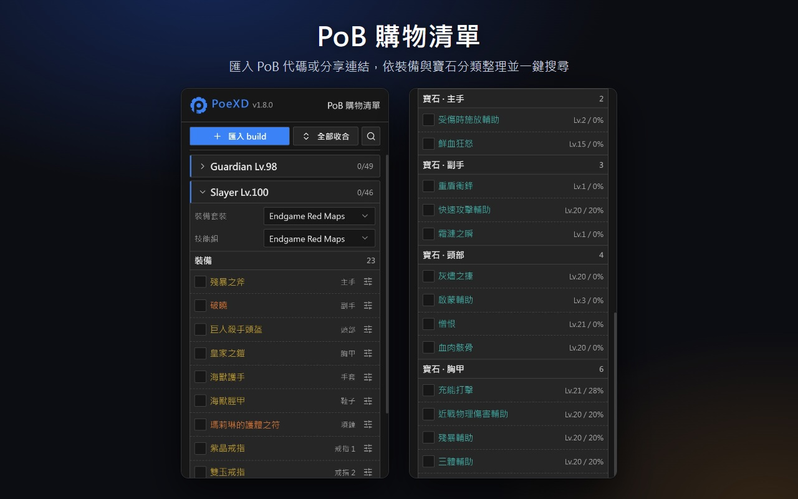
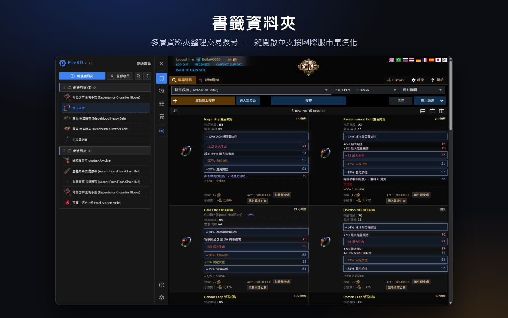
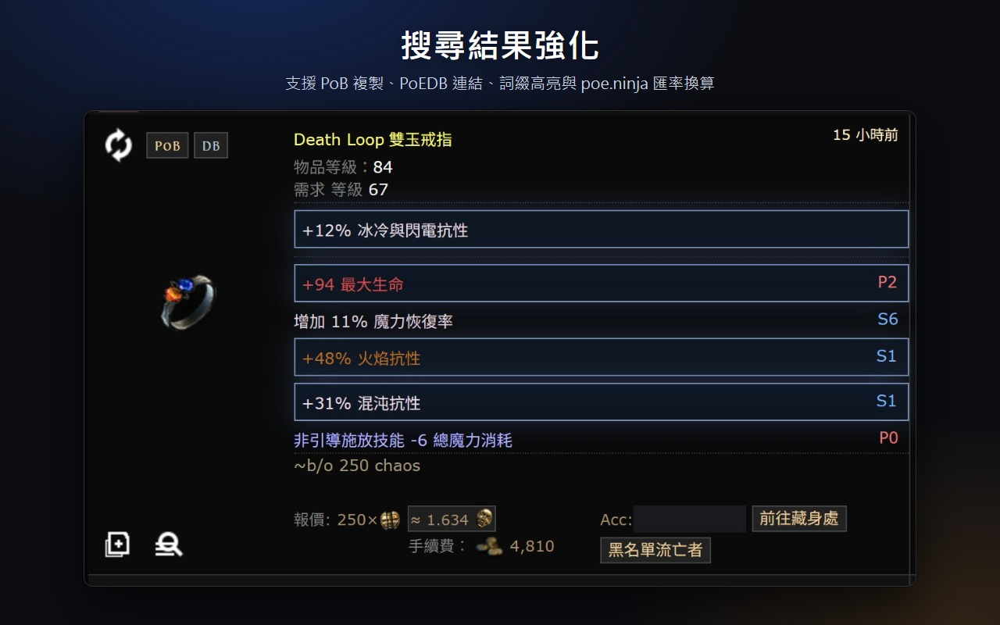

<p align="center">
  
</p>

<p align="center">
  <a href="https://chromewebstore.google.com/detail/fbbkaeekjalfecgjfcephaiopffeobjg"></a>
  <a href="https://microsoftedge.microsoft.com/addons/detail/hnnpgpcnmgjbmmhgogcljbnfoklblgmb"></a>
  <a href="https://yehshune.github.io/poexd/"></a>
  
  
</p>

<p align="center"><b>繁體中文</b> · <a href="./README.en.md">English</a></p>

**PoeXD Extension** 是《流亡黯道》（PoE 1／PoE 2）官方交易市集的輔助擴充套件：在交易頁面旁加上側邊工具列，集中監看即時搜尋、快速套用詞綴、整理書籤與 PoB 採購清單，並把國際服市集翻成中文。完整圖文操作說明請見 [PoeXD 使用教學](https://yehshune.github.io/poexd/)。

## 安裝與初次使用

| 瀏覽器                    | 安裝方式                                                                                                                                                                      |
| :------------------------ | :---------------------------------------------------------------------------------------------------------------------------------------------------------------------------- |
| Chrome、Brave 等 Chromium | [Chrome Web Store](https://chromewebstore.google.com/detail/fbbkaeekjalfecgjfcephaiopffeobjg)                                                                                 |
| Microsoft Edge            | [Edge 附加元件](https://microsoftedge.microsoft.com/addons/detail/hnnpgpcnmgjbmmhgogcljbnfoklblgmb)                                                                           |
| 手動安裝（不會自動更新）  | 到 [Releases](https://github.com/yehshune/PoeXD-Extension/releases) 下載 `chromium.zip` 解壓縮，在 `chrome://extensions/` 開啟「開發人員模式」→「載入未封裝項目」選擇該資料夾 |

商店版會自動更新，建議優先使用；Firefox 目前不提供。

- 裝好後開啟[官方交易網站](https://www.pathofexile.com/trade)（台服、國服也支援），頁面**左側**會出現 PoeXD 側邊工具列（可在設定的「面板位置」改到右側）；縮起時只會留下一個 PoeXD 標誌。
- 在官方交易網站點擊瀏覽器右上角的 PoeXD 圖示可直接切換顯示／收合側邊欄，各項功能模組可在側邊欄的「系統設定」中個別開關；在非交易頁面點擊圖示則可快速前往各服交易市集。詳細步驟見[安裝與初次使用教學](https://yehshune.github.io/poexd/#first-run)。

## 最新更新

- **v1.11.0 搜尋結果看板與設定頁改版**：
  - **搜尋結果看板**：把這次搜尋已取得的結果集中到側邊欄，可篩選、排序，或切到賣家清單找出能在同一個藏身處一次直購多件的賣家，並產生**倉庫搜尋 regex** 一次標出要買的物品；可透過官方「載入更多」一次載入全部（最多 100 筆），前往藏身處的連結過期時會自動重新整理再前往。
  - **設定頁與首次使用**：設定改為單頁並可搜尋、個別開關功能模組、備份還原（同時包含 PoE 1 與 PoE 2）與「在頁面上指出」導覽；介面縮放改為固定比例選單，側邊欄寬度直接拖曳邊緣調整；首次安裝自動開始導覽，在交易頁點工具列圖示即可切換側邊欄。版面、快捷鍵與書籤介面偏好改為 PoE 1 與 PoE 2 共用。
  - **其他改進**：釘選物品新增排序、手續費與詞綴範圍，並與看板一致顯示「賣家 · 時間」；市集漢化可在結果詞綴下方附上英文；詞綴依物等篩選時，較高階級改為停用顯示；點官方結果欄位排序時，價格排序會讓位給官方排序；切換聯盟前若有進行中的即時搜尋會先確認。
- **v1.10.0 釘選物品與詞綴選擇器加速**：
  - **釘選物品**：滑鼠移到搜尋結果即可釘選，在側邊欄以官方樣式卡片回頭比價；支援一般搜尋、即時搜尋與線上搜尋主控台，可搜尋篩選、拖曳排序或拖出取消釘選，賣出的物品會標示已售出，一口價物品可直接前往藏身處。
  - **詞綴選擇器切換更順**：切換到詞綴多的物品類別（如 PoE 1 頭盔、地圖）時改為分批顯示，不再卡住將近一秒。
  - **其他修正**：市集漢化補上魔法與 Foulborn 物品名稱翻譯、PoB 購物清單還原時顯示載入狀態、下拉選單與側邊欄各分頁的樣式統一。

完整紀錄見 [Releases](https://github.com/yehshune/PoeXD-Extension/releases)。

## 功能

完整截圖與操作示範請參考 [PoeXD 使用教學](https://yehshune.github.io/poexd/)。

### ⚡ 線上搜尋主控台

在單一分頁集中監聽多組即時搜尋（Live Search），斷線自動重連，有新物品上架時即時顯示並可播放提示音。支援從書籤挑選或直接貼上搜尋網址、依書籤資料夾分組、批次啟用或停止、只顯示結果區、點單一連線過濾，並即時顯示 API 速率狀態與防止分頁被瀏覽器自動捨棄，重開瀏覽器可恢復上次的連線。

<p align="center"></p>

### 🎯 常用詞綴群組與搜尋預覽

把常用條件（例如「生命 ＋ 總元素抗性」）存成群組，直接疊加到目前的搜尋而不覆蓋其他篩選，套錯可一鍵復原，並支援分享碼與備份檔匯入匯出。點書籤或歷史紀錄名稱會先打開**搜尋預覽**（名稱旁的箭頭才是直接開啟搜尋），可在預覽中微調數值、切換條件群組或只把部分詞綴疊加到目前搜尋；書籤預覽還可直接覆蓋回書籤。

<p align="center">
  
  
</p>

### 🔍 詞綴篩選與 T 階工具

在官方篩選群組旁打開詞綴選擇器，依物品類別與「物等」區間瀏覽前綴／後綴，勾選後一次寫入官方篩選器；篩選欄旁的 T 階按鈕可選階級自動填入數值範圍（同詞綴有多種來源時可在左側切換詞綴分組）；詞綴可拖曳排序或移到其他群組。PoE 2 的碑牌、換界石與範圍珠寶同樣支援。

### 💰 搜尋結果強化

- **價格換算與排序**：依 poe.ninja 匯率換算不同通貨的標價，並可依換算後價格排序（國際服）。
- **結果詞綴高亮與快篩**：標示符合條件的詞綴；滑鼠移到結果中的詞綴右側會出現「`+和`／`+不`」按鈕，可快速加入篩選（只帶入詞綴，不會自動搜尋）。
- **PoB 複製與 PoEDB 連結**：滑鼠移到結果左上角可一鍵複製英文 **PoB** 物品文字（台服與國服會自動轉成英文）或開啟 **PoEDB** 物品頁。
- **PoE 2 符文覆寫試算**：試算符文覆寫後的 DPS／防禦，並可依試算結果排序。

### 📌 釘選物品

滑鼠移到搜尋結果時點釘選，即可把物品連同價格、賣家與上架時間存到側邊欄，以官方樣式卡片回頭比較；一般搜尋、即時搜尋與線上搜尋主控台都能使用。可搜尋篩選、拖曳排序或拖出取消釘選，賣出的物品會標示已售出；一口價物品可直接前往藏身處。每個遊戲版本最多保存 50 筆，資料僅存於本機瀏覽器。

### 🧾 搜尋結果看板

在一般搜尋頁把這次搜尋已取得的結果集中到側邊欄（從側邊欄或官方結果數旁的「看板」按鈕開啟），不會改動官方結果列表。

- **物品清單**：依價格、上架時間等篩選與排序，點一下即可捲到官方結果並高亮；可直接前往藏身處或釘選。
- **賣家清單**：依可直購件數與換算總價排序，找出能在同一個藏身處一次買齊的賣家；勾選要買的物品後顯示小計，並產生**倉庫搜尋 regex**，貼到對方倉庫的搜尋框即可一次標出（只保證和該賣家已載入的其他物品區分，無法區分時會警告）。
- **載入更多**：一律透過官方「載入更多」按鈕，可逐批或一次載入全部（官方上限 100 筆）；已前往與已售出的結果會標示出來。看板不保存任何資料，換搜尋就重來；要留下物品請用釘選。

### 🧩 PoB 購物清單

貼上 Path of Building 匯出代碼，或 `poe.ninja`、`pobb.in`、`pastebin` 分享網址（後兩者需另外授權網站存取，代碼僅存於本機瀏覽器），依裝備欄位與寶石整理並保留多份 build，支援裝備套裝與技能組切換。內建詞綴中文翻譯（含舊版英文寫法），可在預覽微調條件後一鍵搜尋、加入書籤或送入線上搜尋主控台。

### 📁 書籤、歷史紀錄與 TFT 互通

- 樹狀資料夾收納搜尋，支援拖曳排序、封面圖與滑過預覽。
- 目前頁面對應的書籤會自動高亮，並支援以目前搜尋覆蓋既有書籤；書籤會自動套用目前的伺服器與聯盟。
- 自動記錄搜尋歷史；可與 TFT Trade Extension 互相匯入匯出書籤，匯入前先預覽差異。

<p align="center"></p>

### 🌐 市集漢化

把國際服英文市集的介面、篩選器與搜尋結果顯示成中文（支援繁體中文台服用語／簡體中文國服用語），只改變顯示、不影響搜尋內容。開啟「中英並列」時，詞綴、通貨與物品下拉選單會同時呈現中英文，中英文都搜得到，也可在搜尋結果的詞綴下方附上英文；開啟市集漢化並授權 `pobb.in` 後，`pobb.in` 分享頁也會自動顯示中文。

### ⚙️ 設定、快捷鍵與常見問題

- 面板位置（預設左側，可改右側）、主題與介面縮放可調，側邊欄寬度直接拖曳邊緣調整；在側邊欄設定頁可搜尋設定、個別開關功能模組，並備份、還原或重設（同時包含 PoE 1 與 PoE 2）。
- 首次安裝會自動開始導覽，之後可在「工具與資訊」按「開始導覽」重看；設定項目可用「在頁面上指出」直接標出位置。
- 道具名稱與篩選欄支援模糊搜尋（自動加 `~`）、可自訂聚焦／清除搜尋欄快捷鍵（`Backspace` 清除、`Esc` 取消），以及將分頁標題換成目前搜尋的道具名稱。
- 擴充介面提供繁體中文、簡體中文與英文；詞綴資料涵蓋官方交易網站的 11 種語言。
- 更多疑難排解請見 [常見問題](https://yehshune.github.io/poexd/#faq)。

<p align="center"></p>

## 隱私

所有資料都存在你的瀏覽器本機；本專案沒有伺服器，也沒有分析或追蹤程式碼。詳見[隱私權政策](./PRIVACY.md)，安全性問題請依 [SECURITY.md](./SECURITY.md) 私下回報。

## 開發

需要 Node.js `>= 22` 與 pnpm。

```bash
pnpm install
pnpm dev        # Chrome 開發模式（熱重載）
pnpm test       # 單元測試
pnpm compile    # 型別檢查
pnpm build      # 生產建置
```

完整流程與規範見[貢獻指南](./CONTRIBUTING.md)；架構與決策紀錄在 [CONTEXT.md](./CONTEXT.md) 與 [`docs/`](./docs/)。技術棧：WXT、Vue 3、TypeScript、Tailwind CSS 4、Vitest、Playwright。

## 支持與授權

- PoeXD 免費且開源，如果它幫你省下時間，歡迎到[贊助頁](https://yehshune.github.io/support/)支持。
- 本專案為社群維護的非官方工具，與 Grinding Gear Games 或騰訊沒有隸屬或背書關係。「Path of Exile」為 Grinding Gear Games 的商標。
- 原始碼採用 [MIT License](./LICENSE)；`public/json/` 內的遊戲資料版權屬於 Grinding Gear Games，不在 MIT 授權範圍內，詳見 [NOTICE](./NOTICE.md)。
