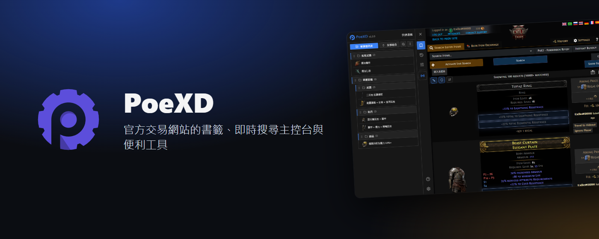
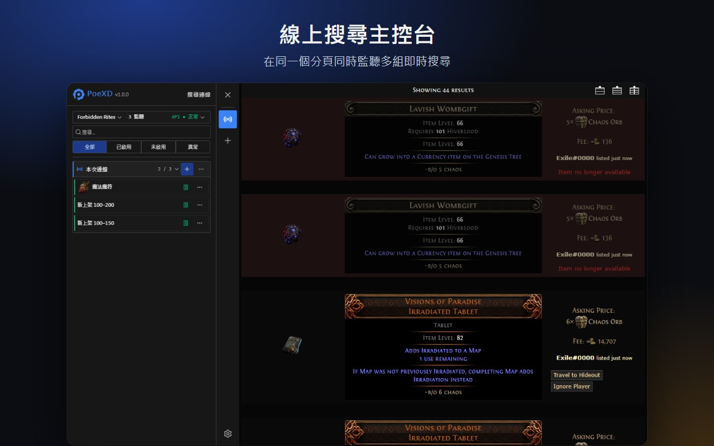
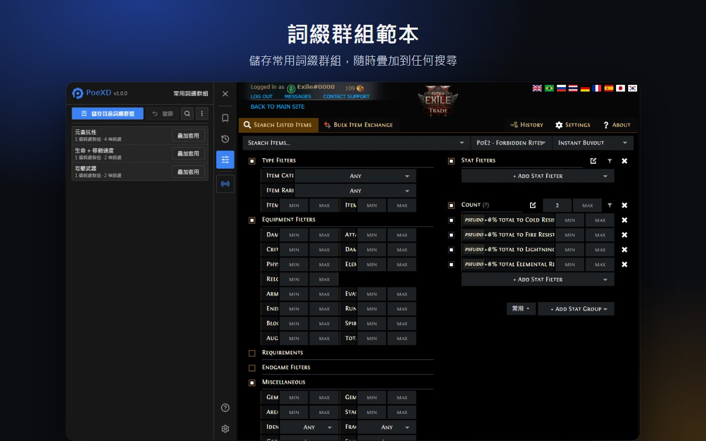
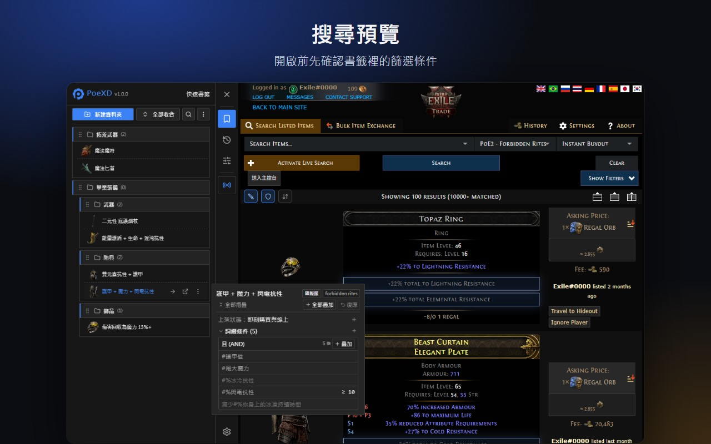
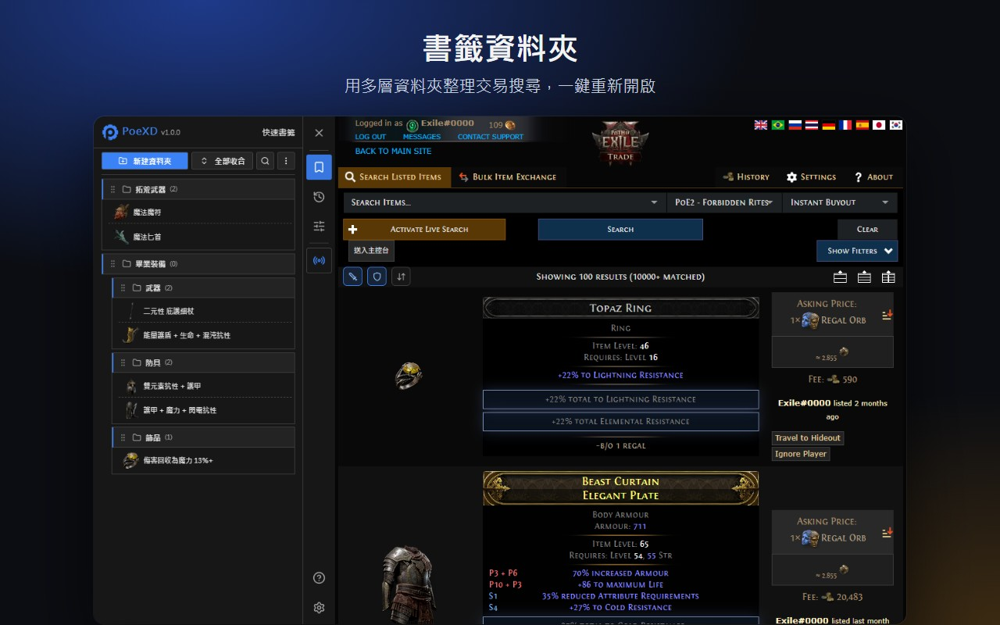
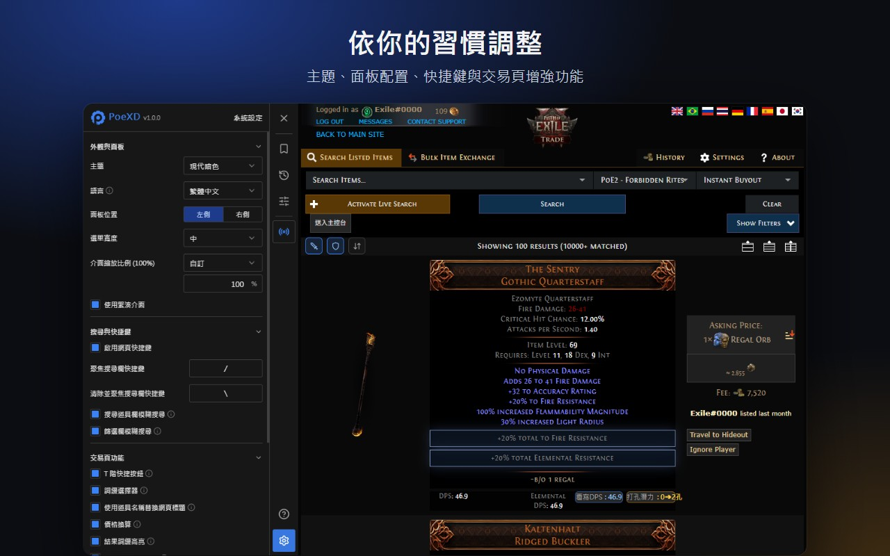

<p align="center">
  
</p>

<p align="center">
  <a href="https://chromewebstore.google.com/detail/fbbkaeekjalfecgjfcephaiopffeobjg"></a>
  <a href="https://microsoftedge.microsoft.com/addons/detail/hnnpgpcnmgjbmmhgogcljbnfoklblgmb"></a>
  
  
</p>

<p align="center"><b>繁體中文</b> · <a href="./README.en.md">English</a></p>

**PoeXD Extension** 是《流亡黯道》（PoE 1／PoE 2）官方交易市集的輔助擴充套件：集中管理即時搜尋、快速套用詞綴、整理書籤，並把國際服市集翻成中文。

## 安裝

| 瀏覽器                    | 安裝方式                                                                                                                                                                      |
| :------------------------ | :---------------------------------------------------------------------------------------------------------------------------------------------------------------------------- |
| Chrome、Brave 等 Chromium | [Chrome Web Store](https://chromewebstore.google.com/detail/fbbkaeekjalfecgjfcephaiopffeobjg)                                                                                 |
| Microsoft Edge            | [Edge 附加元件](https://microsoftedge.microsoft.com/addons/detail/hnnpgpcnmgjbmmhgogcljbnfoklblgmb)                                                                           |
| 手動安裝（不會自動更新）  | 到 [Releases](https://github.com/yehshune/PoeXD-Extension/releases) 下載 `chromium.zip` 解壓縮，在 `chrome://extensions/` 開啟「開發人員模式」→「載入未封裝項目」選擇該資料夾 |

裝好後開啟[官方交易網站](https://www.pathofexile.com/trade)，右側會出現 PoeXD 工具列。商店版會自動更新；Firefox 目前不提供。

## 最新更新

- **市集漢化即時同步官方資料**：開啟市集漢化時，會在背景向台服／國服官方端點抓取並快取最新的介面字典、詞綴、靜態項目與篩選器（6 小時更新週期），改版新詞綴免等擴充發版即可套用，並以打包分片作為離線與首載備援。
- **優先採用官方頁面當下資料**：顯示語系與所在市集一致時，詞綴選擇器與側邊欄篩選器直接讀取官方頁面已載入的篩選標籤與詞綴寫法（含 pseudo 屬性），改版當天即同步官網最新欄位。
- **PoE 1 3.30 資料更新**：同步 3.30 版本的詞綴、物品、地圖篩選與市集漢化分片資料。
- **首次安裝導覽與穩定性改善**：初次安裝時顯示歡迎導覽卡與側邊欄展開提示；加強本機書籤／搜尋紀錄覆寫前的備份保護與跨環境事件隔離。

完整紀錄見 [Releases](https://github.com/yehshune/PoeXD-Extension/releases)。

## 功能

### ⚡ 線上搜尋主控台

在單一分頁集中監聽多組即時搜尋，斷線自動重連；依書籤資料夾分組、批次啟用或停止，重開瀏覽器可恢復上次的連線。只顯示結果區、可點單一連線過濾，並即時顯示 API 速率狀態，避免觸發官方限制。

<p align="center"></p>

### 🎯 常用詞綴群組與搜尋預覽

把常用條件（例如「生命 + 總元素抗性」）存成群組，直接疊加到目前的搜尋，不覆蓋其他篩選，套錯可一鍵復原；可用分享碼或備份檔匯入匯出。搜尋預覽能看到歷史紀錄或書籤背後的實際條件，並單獨疊加其中的詞綴。

<p align="center">
  
  
</p>

### 🔍 詞綴篩選與階級工具

依物品類別瀏覽前綴／後綴、勾選後一次寫入官方篩選器；篩選欄旁的 T 階按鈕一鍵填入數值範圍；詞綴可拖曳排序或移到其他群組。PoE 2 碑牌、換界石與範圍珠寶也支援。

### 💰 搜尋結果強化

依 poe.ninja 匯率換算不同通貨的標價（國際服）、標示符合條件的詞綴，以及 PoE 2 符文覆寫後的 DPS／防禦試算與排序。

### 📁 書籤、歷史紀錄與 TFT 互通

樹狀資料夾收納搜尋，支援拖曳、封面圖與滑過預覽；書籤會自動套用目前的伺服器與聯盟。自動記錄搜尋歷史。可與 TFT Trade Extension 互相匯入匯出書籤，匯入前可預覽差異。

<p align="center"></p>

### ⚙️ 其他

- 道具名稱與篩選欄模糊搜尋（自動加 `~`）、聚焦／清除搜尋欄快捷鍵、分頁標題顯示道具名稱。
- 主題、面板位置、寬度與縮放可調整；點工具列圖示即可開關各項功能。
- 擴充介面提供繁體中文、簡體中文與英文；詞綴資料涵蓋官方交易網站的 11 種語言。

<p align="center"></p>

## 隱私

所有資料都存在你的瀏覽器本機；本專案沒有伺服器，也沒有分析或追蹤程式碼。詳見[隱私權政策](./PRIVACY.md)，安全性問題請依 [SECURITY.md](./SECURITY.md) 私下回報。

## 開發

需要 Node.js `>= 22` 與 pnpm。

```bash
pnpm install
pnpm dev        # Chrome 開發模式（熱重載）
pnpm test       # 單元測試
pnpm compile    # 型別檢查
pnpm build      # 生產建置
```

完整流程與規範見[貢獻指南](./CONTRIBUTING.md)；架構與決策紀錄在 [CONTEXT.md](./CONTEXT.md) 與 [`docs/`](./docs/)。技術棧：WXT、Vue 3、TypeScript、Tailwind CSS 4、Vitest、Playwright。

## 支持與授權

- PoeXD 免費且開源，如果它幫你省下時間，歡迎到[贊助頁](https://yehshune.github.io/support/)支持。
- 本專案為社群維護的非官方工具，與 Grinding Gear Games 或騰訊沒有隸屬或背書關係。「Path of Exile」為 Grinding Gear Games 的商標。
- 原始碼採用 [MIT License](./LICENSE)；`public/json/` 內的遊戲資料版權屬於 Grinding Gear Games，不在 MIT 授權範圍內，詳見 [NOTICE](./NOTICE.md)。
