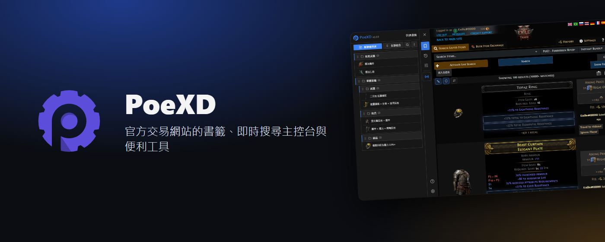

<p align="center">
  
</p>

<p align="center">
  <a href="https://chromewebstore.google.com/detail/fbbkaeekjalfecgjfcephaiopffeobjg"></a>
  <a href="https://microsoftedge.microsoft.com/addons/detail/hnnpgpcnmgjbmmhgogcljbnfoklblgmb"></a>
  <a href="https://yehshune.github.io/poexd/"></a>
  
  
</p>

<p align="center"><b>繁體中文</b> · <a href="./README.en.md">English</a></p>

**PoeXD Extension** 是《流亡黯道》（PoE 1／PoE 2）官方交易市集的輔助擴充套件：在交易頁面旁加上側邊工具列，集中監看即時搜尋、快速套用詞綴、整理書籤與 PoB 採購清單，並把國際服市集翻成中文。

<p align="center"><a href="https://yehshune.github.io/poexd/"><b>👉 完整功能介紹與圖文教學：PoeXD 使用教學</b></a></p>

## 安裝

| 瀏覽器                    | 安裝方式                                                                                                                                                                      |
| :------------------------ | :---------------------------------------------------------------------------------------------------------------------------------------------------------------------------- |
| Chrome、Brave 等 Chromium | [Chrome Web Store](https://chromewebstore.google.com/detail/fbbkaeekjalfecgjfcephaiopffeobjg)                                                                                 |
| Microsoft Edge            | [Edge 附加元件](https://microsoftedge.microsoft.com/addons/detail/hnnpgpcnmgjbmmhgogcljbnfoklblgmb)                                                                           |
| 手動安裝（不會自動更新）  | 到 [Releases](https://github.com/yehshune/PoeXD-Extension/releases) 下載 `chromium.zip` 解壓縮，在 `chrome://extensions/` 開啟「開發人員模式」→「載入未封裝項目」選擇該資料夾 |

商店版會自動更新，建議優先使用；Firefox 目前不提供。裝好後開啟[官方交易網站](https://www.pathofexile.com/trade)（台服、騰訊服也支援），頁面左側就會出現 PoeXD 側邊工具列，首次使用會自動開始導覽，詳見[安裝與初次使用](https://yehshune.github.io/poexd/#first-run)。

## 功能一覽

| 功能                                                                        | 說明                                                                                                        |
| :-------------------------------------------------------------------------- | :---------------------------------------------------------------------------------------------------------- |
| [⚡ 線上搜尋主控台](https://yehshune.github.io/poexd/#live-search)          | 單一分頁監聽多組即時搜尋，斷線自動重連，支援提示音與桌面通知                                                |
| [🎯 常用詞綴群組與搜尋預覽](https://yehshune.github.io/poexd/#stat-groups)  | 把常用條件存成群組疊加到目前搜尋，開啟前先預覽並微調                                                        |
| [🔍 詞綴篩選與 T 階工具](https://yehshune.github.io/poexd/#affix)           | 依物品類別與物等瀏覽詞綴，選階級自動填入數值範圍                                                            |
| [💰 搜尋結果強化](https://yehshune.github.io/poexd/#results)                | poe.ninja 價格換算排序、詞綴高亮快篩、PoB 複製、PoEDB 連結、符文試算                                        |
| [📌 釘選物品](https://yehshune.github.io/poexd/#pinned)                     | 把結果連同價格與賣家存到側邊欄回頭比較，賣出會標示                                                          |
| [🧾 搜尋結果看板](https://yehshune.github.io/poexd/#result-board)           | 集中篩選排序這次搜尋的結果，找出可一次直購多件的賣家並產生倉庫 regex                                        |
| [🧩 PoB 購物清單](https://yehshune.github.io/poexd/#pob)                    | 匯入 PoB 代碼或分享網址，以裝備紙娃娃檢視並一鍵產生搜尋                                                     |
| [📁 書籤、歷史紀錄與 TFT 互通](https://yehshune.github.io/poexd/#bookmarks) | 樹狀資料夾（可自訂圖示與顏色）、自動歷史紀錄、與 TFT 互相匯入匯出                                           |
| [🌐 市集漢化](https://yehshune.github.io/poexd/#translation)                | 國際服市集顯示為繁體／簡體中文，可中英並列                                                                  |
| [⚙️ 設定與常見問題](https://yehshune.github.io/poexd/#settings)             | 主題與自訂配色、介面縮放、快捷鍵、模組開關、備份還原；另見[常見問題](https://yehshune.github.io/poexd/#faq) |

更新紀錄見 [Releases](https://github.com/yehshune/PoeXD-Extension/releases)。

## 問題回報

遇到錯誤或有功能建議，請到 [GitHub Issues](https://github.com/yehshune/PoeXD-Extension/issues) 回報，附上擴充版本、瀏覽器、PoE 1 或 2、伺服器（國際服／台服／騰訊服）與重現步驟會更快處理。回報時請不要貼出 `POESESSID` 等 cookie。

## 隱私

所有資料都存在你的瀏覽器本機；本專案沒有伺服器，也沒有分析或追蹤程式碼。詳見[隱私權政策](./PRIVACY.md)，安全性問題請依 [SECURITY.md](./SECURITY.md) 私下回報。

## 開發

需要 Node.js `>= 22` 與 pnpm。

```bash
pnpm install
pnpm dev        # Chrome 開發模式（熱重載）
pnpm test       # 單元測試
pnpm compile    # 型別檢查
pnpm build      # 生產建置
```

完整流程與規範見[貢獻指南](./CONTRIBUTING.md)；架構與決策紀錄在 [GLOSSARY.md](./GLOSSARY.md) 與 [`docs/`](./docs/)。技術棧：WXT、Vue 3、TypeScript、Tailwind CSS 4、Vitest、Playwright。

## 支持與授權

- PoeXD 免費且開源，如果它幫你省下時間，歡迎到[贊助頁](https://yehshune.github.io/support/)支持。
- 本專案為社群維護的非官方工具，與 Grinding Gear Games 或騰訊沒有隸屬或背書關係。「Path of Exile」為 Grinding Gear Games 的商標。
- 原始碼採用 [MIT License](./LICENSE)；`public/json/` 內的遊戲資料版權屬於 Grinding Gear Games，不在 MIT 授權範圍內，詳見 [NOTICE](./NOTICE.md)。
